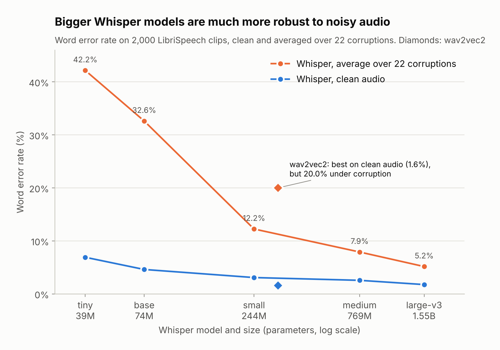
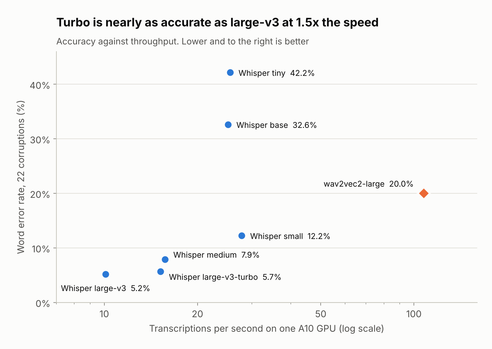
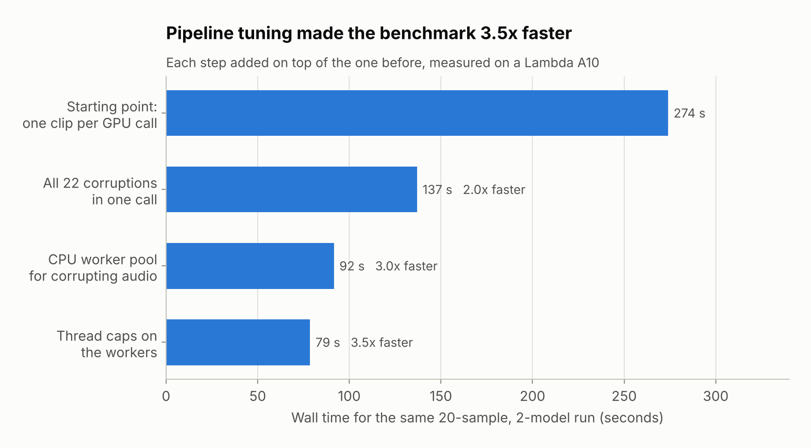

# Noisy-Speech ASR Benchmark

**How well does speech recognition hold up when the audio is bad?** This project measures it at scale. I ran 2,000 LibriSpeech recordings through 22 kinds of damage (noise, reverb, dropouts, codecs, packet loss, band limiting, clipping) and transcribed every version with 7 models: the Whisper family from tiny to large-v3, plus wav2vec2 as a contrast. That is 308,000 transcriptions, run on one cloud GPU (an NVIDIA A10) in 4.4 hours.

## Key results

- **Model size buys robustness.** On clean audio the Whisper models range from 6.9% (tiny) to 1.8% (large-v3) word error rate. Over the 22 corruptions the gap widens to 42% against 5.2%.
- **Best on clean audio doesn't mean best on real audio.** wav2vec2 has the lowest clean error rate (1.6%) but reaches 20% under corruption. It collapses on heavy packet loss (83%), clipping (34%) and noise (40%), where large-v3 stays at 3-6%.
- **Whisper large-v3-turbo is the practical pick.** It is within 0.5 points of large-v3 on 18 of the 22 corruptions and runs 1.5x faster.
- **Small models fail by looping.** On badly damaged audio, Whisper tiny and base repeat a phrase until they hit the token limit. That inflates their error rate and takes 15% of all GPU time.
- **The pipeline is reproducible.** A second full run, two weeks later, produced all 308,000 transcripts character for character.

The error rate for every model and corruption is in [this heatmap](docs/figures/wer_by_corruption.png). The full analysis is in [`analysis/v2/`](analysis/v2/README.md).

## At a glance

| | |
|---|---|
| **Question** | How does noise robustness scale with model size, and how does a differently trained model compare? |
| **Data** | LibriSpeech test-clean: 2,000 recordings, 4.3 hours of speech |
| **Corruptions** | 22, from mild (8 kbps codec) to severe (500-1000 Hz band limit, combined noise + reverb + dropouts) |
| **Models** | Whisper tiny, base, small, medium, large-v3 and large-v3-turbo; wav2vec2-large |
| **Metrics** | Word and character error rate, plus audio-health metrics for every clip |
| **Scale and hardware** | 308,000 transcriptions on one NVIDIA A10 (24 GB): 4.4 h, about 5.3 h with the follow-up passes. 98% of the time is GPU inference; GPU memory peaked at 21.8 of the 22.5 GiB available |

## What I built

A pipeline that takes a benchmark from a workstation to a cloud GPU run:

- **Fast by design.** CPU workers corrupt the audio in parallel while the GPU transcribes, and each sample's 22 versions go to the model in one batch. In a full run, GPU inference takes 98% of the time and the audio preparation is fully hidden behind it.
- **One-command cloud runs.** One command runs the benchmark on a Lambda Labs GPU, uploads the results to Google Cloud Storage, verifies them and shuts the instance down. Phone notifications report start, failure and completion.
- **Built to survive failures.** Results are saved every 50 samples, so a crashed run resumes where it stopped, and the instance is only shut down if every run succeeded.
- **Reproducible.** Seeded corruptions, pinned library versions in a Docker image, and every run records its code version, settings and library versions.
- **Measured, then tuned.** Every phase is timed. The measurements guided the tuning, which made the same test run 3.5x faster:

- **Tested.** 45 tests cover the configuration, the models' batching and the cloud scripts, without needing a GPU, network or credentials.

**Stack:** Python, PyTorch, Hugging Face Transformers, MLX (Apple Silicon), NumPy, librosa, jiwer, Docker, Bash, Google Cloud Storage, Lambda Labs.

## Repository

| Path | What it is |
|---|---|
| [`src/asr_pipeline_benchmark/`](src/asr_pipeline_benchmark/) | The pipeline: corruptions, audio-health metrics, models, checkpointing, storage |
| [`app.py`](app.py) | Entry point for one benchmark run |
| `run_and_terminate.sh`, `run_sweep.sh` | Cloud runs and benchmark sweeps |
| [`analysis/`](analysis/) | Results and timing analysis of the full runs, and the scripts that compute them |
| [`docs/figures/`](docs/figures/) | The figures above |
| [`tests/`](tests/) | Test suite |

## Run it yourself

Setup, configuration, local runs on Apple Silicon and cloud runs on a GPU are covered in [Getting started](docs/getting-started.md).
